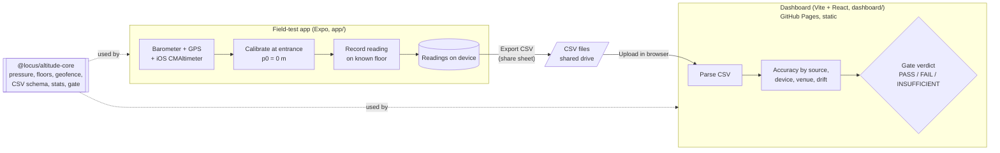
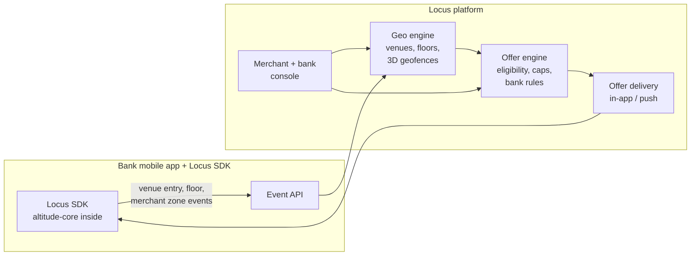

# Architecture

## MVP (this repository)

The MVP answers one question: can a phone tell which mall floor it is on? It is deliberately serverless. Data moves from phone to analyst as a CSV file the tester exports by hand.

| Component | Responsibility | Runs on |
| --- | --- | --- |
| [`packages/altitude-core`](../packages/altitude-core) | All domain logic: hypsometric pressure-to-height, floor bands, 3D geofence test, CSV read/write, accuracy statistics, `evaluateGate`. Pure TypeScript, no I/O. | Phone and browser |
| [`app/`](../app) | Sensor access, calibration and recording UX, venue/floor tables, CSV export. | iOS / Android via Expo Go |
| [`dashboard/`](../dashboard) | CSV upload, charts, gate verdict. Everything in the browser. | GitHub Pages |

Key design choices:

- **One shared library** means the phone's floor estimate and the dashboard's verdict use the same maths and the same CSV schema; a schema change is one pull request with tests.
- **CSV as the contract** between app and dashboard, so no backend, no accounts and no personal data stored anywhere but the tester's phone and the team drive.
- **Relative altitude** from an entrance calibration ([ADR 0001](adr/0001-barometer-relative-altitude.md)).

CI ([`ci.yml`](../.github/workflows/ci.yml)) tests and typechecks every workspace and builds the dashboard; [`pages.yml`](../.github/workflows/pages.yml) deploys it.

## From MVP to the Locus platform

If the gate passes, the MVP pieces map onto the full platform as follows.

| MVP piece | Becomes | Notes |
| --- | --- | --- |
| `altitude-core` pressure + floors | **On-device floor estimator** in the Locus SDK embedded in bank apps | Same code; auto-calibration at known entrances replaces the manual Calibrate button. |
| `altitude-core` geofence (`Geofence3D`) | **Geo engine**: venue registry, floor tables, merchant 3D geofences | Venue and floor tables move from the app into a managed service; the SDK downloads them per venue. Matching stays on device where possible to limit location data leaving the phone. |
| App venue and floor tables | Geo engine admin data, maintained per mall | Field-test venue sheets seed the first entries. |
| Field-test CSV + dashboard stats | **Monitoring**: per-venue, per-device floor accuracy from opt-in telemetry | The gate becomes an ongoing quality metric per venue. |
| (not in MVP) | **Offer engine**: merchant offers, bank card rules, frequency caps, consent | Consumes "user on floor F near merchant M" events from the geo engine. |
| (fallback, not in MVP) | BLE / Wi-Fi floor source in the geo engine | Plugs in as another altitude/floor source if the barometer fails the gate in some venues. |

Privacy carries over as a principle: compute location on the device, send the platform the minimum (venue and zone events, not raw traces), and require explicit consent in the bank app.
